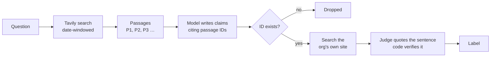

<div align="center">

# Source Anchor

### A research agent where every claim shows its work.


</div>

<br/>

## The problem

You ask a research agent what changed this year. It returns five confident sentences and a list of links.

Now you check all five. Which link backs which sentence? Did the company say it, or did a blog say the company said it? Is that number real?

**An answer you have to re-check is not an answer.** It's homework with a confident tone.

<br/>

## Why it matters

| Who | What it costs them |
|---|---|
| **The analyst** | Reads twenty sources to verify five sentences. The agent saved nothing. |
| **The startup** shipping a research product | Can't put an unauditable answer in front of customers. The feature doesn't ship. |
| **The enterprise** | Can't approve an agent whose output nobody can trace. It never leaves pilot. |
| **Tavily** | Gets paid when agents reach production. Trust is the gate. Nothing passes it. |

<br/>

## The idea

Make every sentence show its work — the actual passage, next to the claim, with a label that says **who said it**.

```
PRIMARY    OpenAI announced the public beta of its Agents API on September 10, 2026.
           openai.com: "Introducing the Agents API. Build and run cloud agents with
           the Codex harness, fully managed by OpenAI."

REPORTED   GPT-6.1 Sol launched September 29, priced at $2 per million input tokens.
           tech-insider.org states this. OpenAI's own site does not.
```

The reader stops checking everything. They check the ones marked `REPORTED`.

*Real output from the shipped code.* Four labels: **`PRIMARY`** the company's own page states it · **`REPORTED`** only third parties do · **`SYNTHESIS`** a market-level statement · **`UNSUPPORTED`** no source states it.

<br/>

## Four promises, kept by code

| Promise | How |
|---|---|
| **No invented sources** | A claim may only cite passages Tavily actually returned. Cite one that doesn't exist — dropped. |
| **No misquotes** | A judge copies the exact sentence that states the claim. Code confirms it's in the passage. |
| **Who said it** | One search restricted to the organization's own site. The label says originator or press. |
| **No invented numbers** | Every figure is checked against the passages. A number no source has — flagged. |

These hold no matter how good the model is. They run in code, on text already in memory.

<br/>

## Proof

<div align="center">

| **12 / 12** | **88%** | **0** |
|:---:|:---:|:---:|
| quoted spans found on their real source pages | of deliberately broken claims caught (wrong numbers: 10/10) | wrong flags in the shipped default output |

</div>

Measured, not asserted: 51 tests, four live runs, and every cited page opened and checked by hand. The one label that proved unreliable — "this passage contradicts the claim" — was wrong three times out of three against the real pages. So it's **off by default**. A red flag you have to disprove is worse than no flag.

<br/>

## How it works



One file of trust logic, `grounding.py`. No LangChain dependency. Drops into any agent that calls Tavily.

<br/>

## Try it

```bash
cp .env.example .env     # TAVILY_API_KEY and NEBIUS_API_KEY
uv run research_agent.py "What did OpenAI announce for its API this year?" --model Qwen/Qwen3-235B-A22B-Instruct-2507
uv run pytest            # 51 tests, no keys needed
```

<br/>

## Go deeper

| | |
|---|---|
| [**TECHNICAL_STATEMENT.md**](TECHNICAL_STATEMENT.md) | The approach and the value, in one page. |
| [**DETAILS.md**](DETAILS.md) | Rejected designs, live results, the correctness check, cost, limits, what's next. |
| [**VERIFICATION.md**](VERIFICATION.md) | Every promise traced to the code, the test, and the live run. |
| [**BUILD_LOG.md**](BUILD_LOG.md) | How it was built — including what the AI got wrong and what I did about it. |

<br/>

<div align="center">

*Every label is about the passages, never about the world.*
*`PRIMARY` means the organization said it — not that it's true.*

</div>
